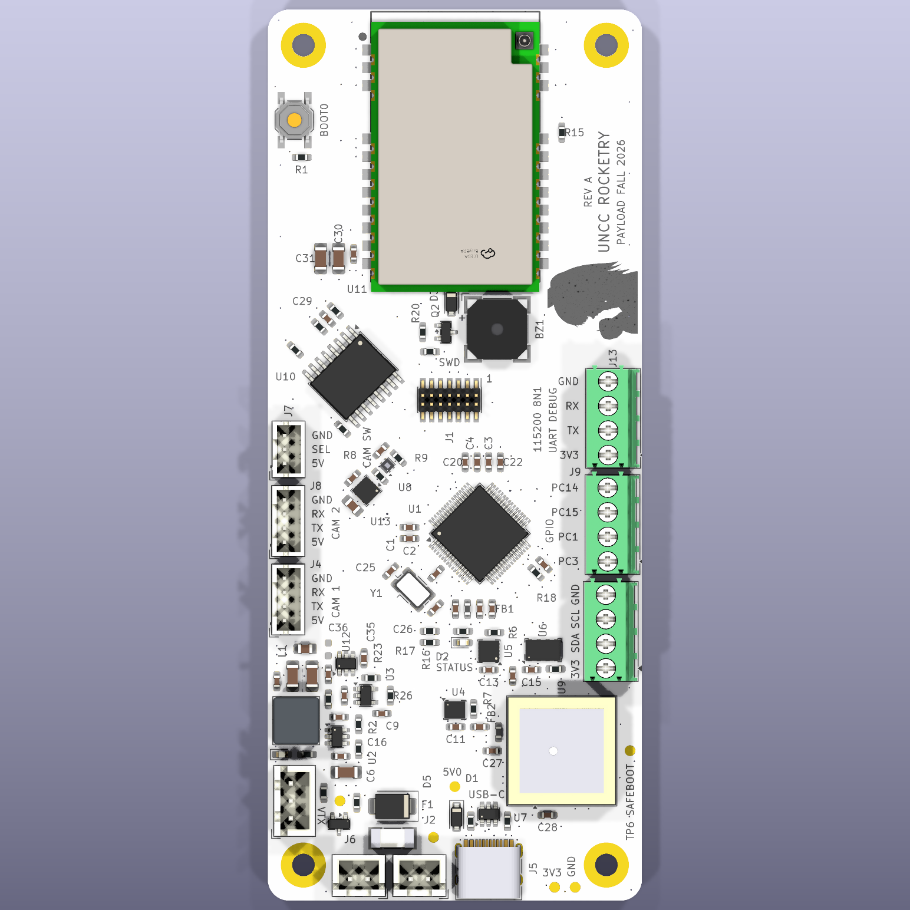
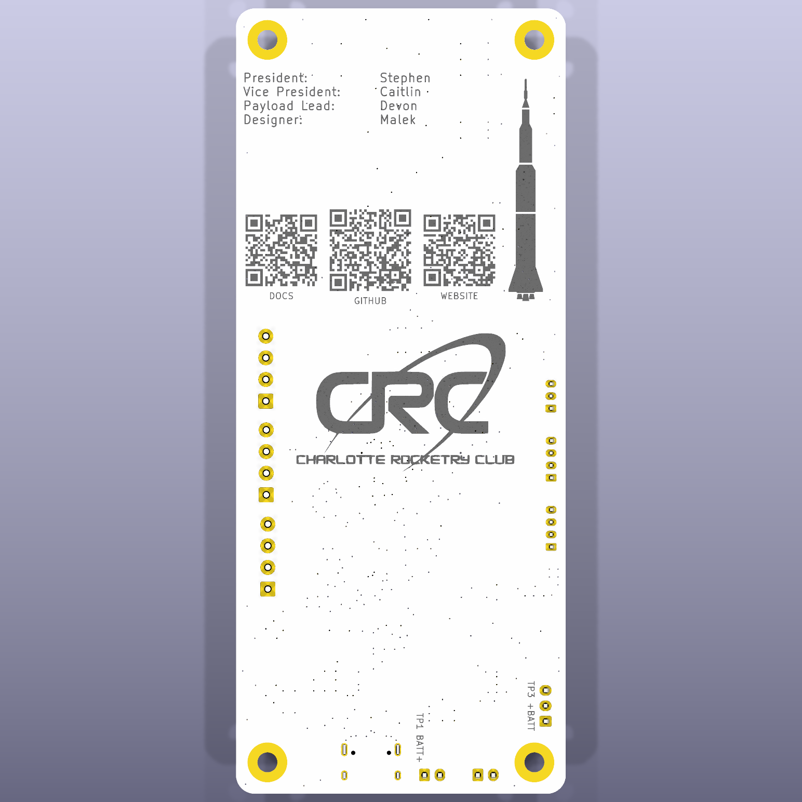
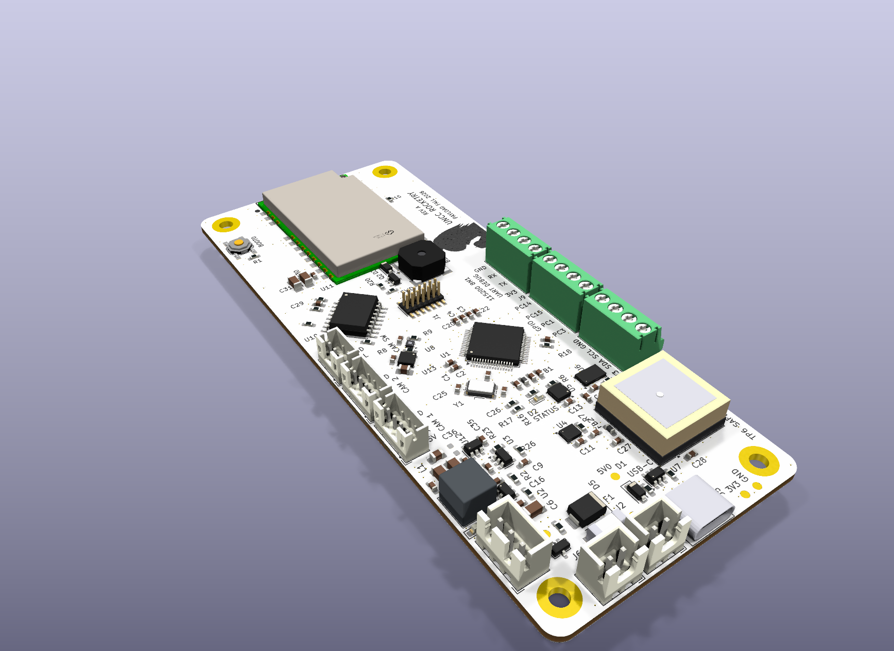
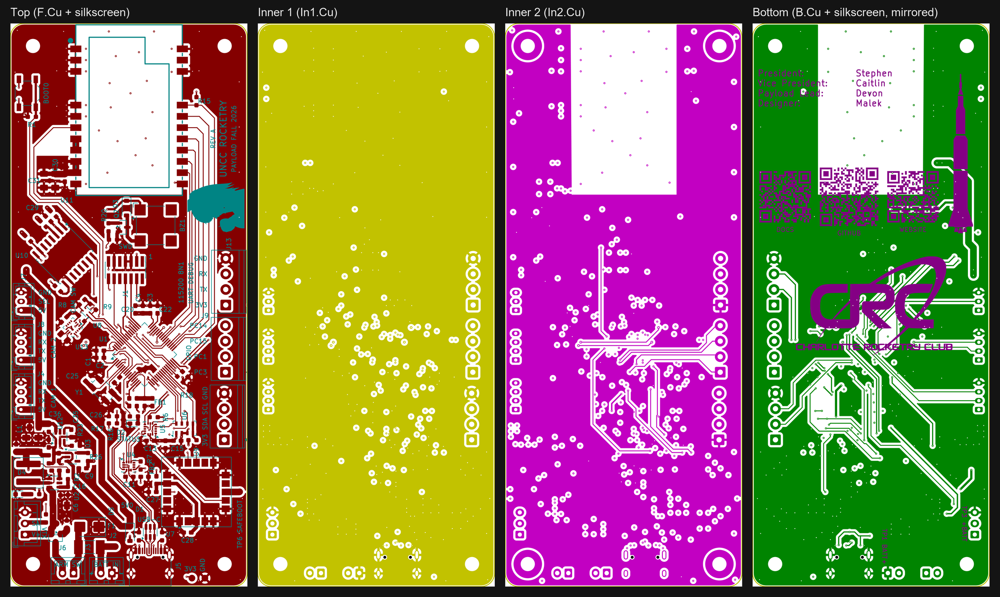
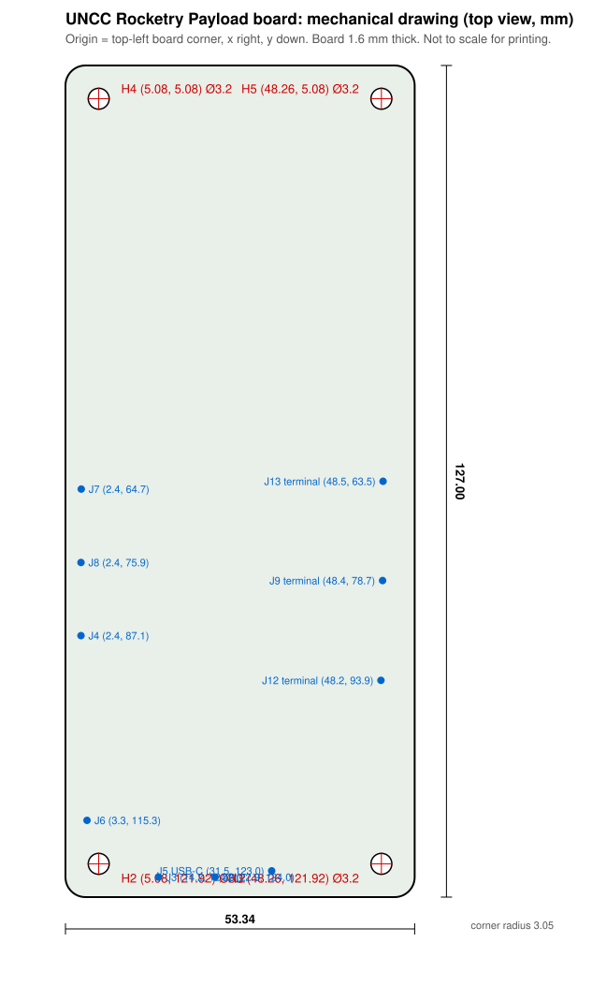
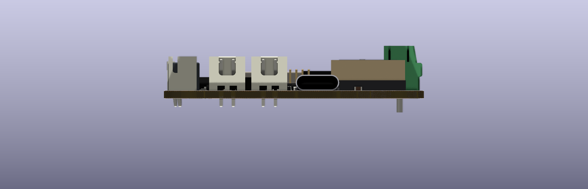

# UNCC Rocketry Payload, Fall 2026

Custom avionics board for the UNC Charlotte rocketry club's transonic payload. It logs flight data, tracks position, sends live telemetry and pad status to a ground station, and controls an onboard camera.

## Layout

The schematic is split into hierarchical sheets, all tied together on the root sheet:

| Sheet | Contents |
|---|---|
| POWER | 5V buck, 3.3V regulator, power LED, bring-up jumpers and camera power switch |
| MCU | Microcontroller, clock, reset/boot, battery voltage sense, buzzer and status LED |
| SENSORS | Inertial, pressure and environmental sensors |
| RF | LoRa telemetry radio and GPS |
| FLASH | Onboard flight data storage |
| CONNECTORS | Battery input protection, arming switch, debug header, camera and USB-C |

## Tools

Designed in KiCad 10. Open `UNCC_ROCKETRY_PAYLOAD_FALL_2026.kicad_pro` to get started.

No KiCad? Download [Schematic.pdf](Schematic.pdf) to view the full schematic.

## Board

4-layer, 53.34 x 127.0 mm board, designed to JLCPCB's standard 4-layer rules.

| Top | Bottom |
|---|---|
|  |  |

### PCB layout

Routed copper on all four layers, with silkscreen on the top and bottom (bottom view is mirrored).

## Dashboard
Take a look at live telemetry at telemetry.malekalbdoor.com

## Mechanical

3D models and dimensions for the mechanical team. Everything is in millimetres.

| File | What it is |
|---|---|
| [mechanical/UNCC_ROCKETRY_PAYLOAD_FALL_2026.step](mechanical/UNCC_ROCKETRY_PAYLOAD_FALL_2026.step) | Full board with all components (STEP) |
| [mechanical/UNCC_ROCKETRY_PAYLOAD_FALL_2026_board_only.step](mechanical/UNCC_ROCKETRY_PAYLOAD_FALL_2026_board_only.step) | Bare board, no components (STEP) |
| [mechanical/UNCC_ROCKETRY_PAYLOAD_FALL_2026.stl](mechanical/UNCC_ROCKETRY_PAYLOAD_FALL_2026.stl) | Full board with all components (STL mesh) |
| [mechanical/UNCC_ROCKETRY_PAYLOAD_FALL_2026_board_only.stl](mechanical/UNCC_ROCKETRY_PAYLOAD_FALL_2026_board_only.stl) | Bare board, no components (STL mesh) |
| [mechanical/UNCC_ROCKETRY_PAYLOAD_FALL_2026_outline.dxf](mechanical/UNCC_ROCKETRY_PAYLOAD_FALL_2026_outline.dxf) | Board outline for CAD (DXF) |
| [images/board_dimensions.svg](images/board_dimensions.svg) | Dimensioned drawing with mounting holes and connector positions |

| Item | Value |
|---|---|
| Board size | 53.34 x 127.0 mm, corner radius 3.05 mm |
| Board thickness | 1.6 mm |
| Mounting holes | 4 x 3.2 mm (M3), 5.08 mm in from each side edge and 5.08 mm in from the short edges |
| Hole positions (x, y from top-left corner) | (5.08, 5.08), (48.26, 5.08), (5.08, 121.92), (48.26, 121.92) |
| Tallest part on top | about 9.2 mm above the board, the three screw terminals on the right edge |
| Other parts on top | up to about 7 mm above the board |
| Lead tails under the board | about 2.9 mm below the bottom face (screw terminals), 1.8 mm elsewhere |
| Connectors on the edges | USB-C and two battery/switch JSTs on the bottom short edge, three camera JSTs and the VTX JST on the left edge, three screw terminals on the right edge |

Heights come from the KiCad 3D models, so check them against the part datasheets before you design a tight enclosure. Connector positions are listed on the dimensioned drawing.

## Status

PCB layout is routed and passes design rules; only silkscreen warnings remain. Firmware is being developed on breadboarded breakout boards in parallel.

## License

Copyright (c) 2026 Malek Albdoor.

Everything in this repository (schematics, PCB layout, 3D models, firmware and the telemetry dashboard) is licensed under [Creative Commons Attribution-NonCommercial 4.0](LICENSE) (CC BY-NC 4.0).

- **You can** use, copy, modify and share it for noncommercial purposes, such as personal projects, school teams and research.
- **You must** credit both Malek Albdoor and the [Charlotte Rocketry Club](https://www.charlotterocketry.org/) at UNC Charlotte, link back to this repository, and say if you changed anything.
- **You cannot** use it, or anything made from it, to make money without written permission.

Credit it like this:

> Based on the UNCC Rocketry payload board by Malek Albdoor and the Charlotte Rocketry Club at UNC Charlotte (https://www.charlotterocketry.org/), https://github.com/MalekAlbdoor/UNCC_ROCKETRY_PAYLOAD_FALL_2026, CC BY-NC 4.0.

Libraries and KiCad library parts used by this project keep their own licenses.
